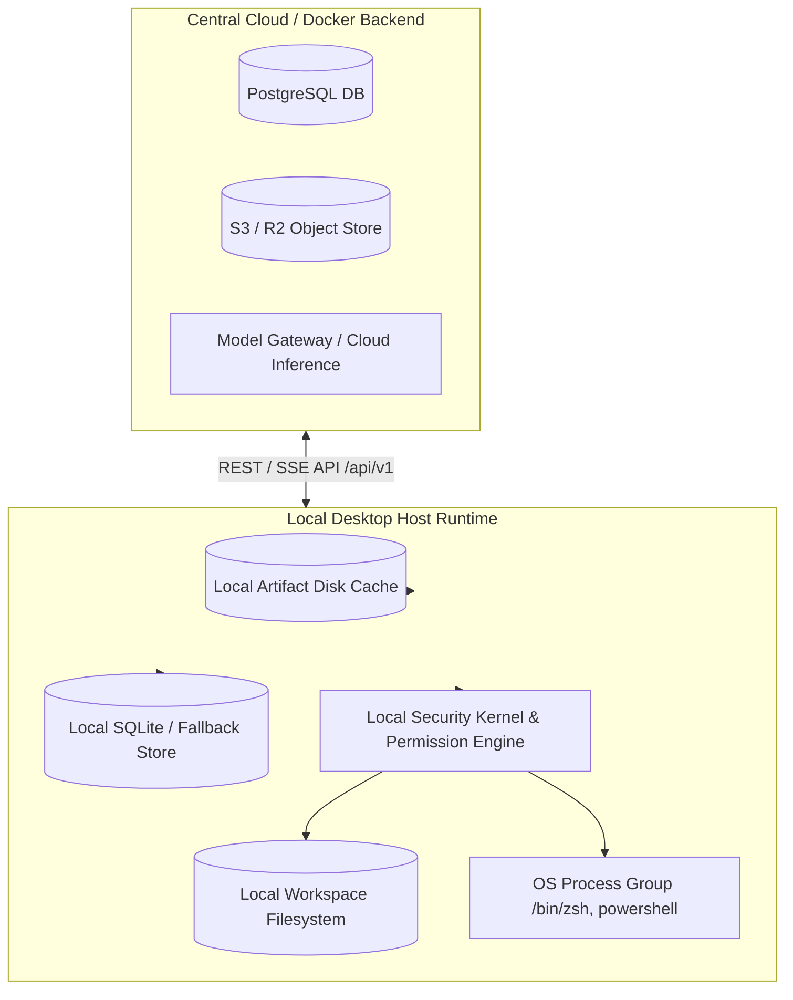

# Gram Desktop Sync & Storage Architecture

This blueprint documents the synchronization, storage, and state consistency architecture for the native Gram Desktop application across PostgreSQL, S3/R2 object storage, and the local host runtime.

---

## 1. Chat & State Synchronization: Real-Time Freshness & Stale Data Prevention

### The Problem
The desktop app can sleep, be minimized, or operate concurrently across multiple devices (e.g., laptop, desktop, web). Background runs, scheduled maintenance, or chat messages initiated from other clients can advance conversation state while the desktop client is dormant.

### Architecture & Mechanisms

1. **Wake-from-Sleep & App Focus Reconciliation**:
   - Hook OS lifecycle and power events (`Window.Activated`, `visibilitychange`, system resume from sleep).
   - Triggers an immediate, non-blocking `ReconcileAsync()` to refresh conversation versions and active status.

2. **Optimistic Concurrency & ETag / Version-Vector Polling**:
   - Backend conversation entities track `int Version` and `DateTimeOffset Updated`.
   - Desktop sync requests to `/api/v1/conversations` supply `If-Modified-Since: {timestamp}` or `If-None-Match: "v{localMaxVersion}"`.
   - When no mutations occurred, the server responds with `304 Not Modified`, minimizing bandwidth and database serialization overhead.
   - If an edit or message submission conflicts with an updated version (`request.Version != conversation.Version`), `ConversationVersionConflictException` is handled gracefully with a prompt to merge or review updates.

3. **Persistent App-Level Event Notification Stream**:
   - Beyond run-scoped Server-Sent Events (`/api/v1/runs/{id}/events`), establish a persistent, lightweight notification channel (`/api/v1/events` SSE or SignalR hub).
   - Broadcasts coarse domain events:
     - `conversation.updated` (`{ id, version, updatedBy }`)
     - `conversation.created`
     - `artifact.created`
     - `permission.requested`
   - The desktop client receives `conversation.updated` and invalidates local cache for the affected conversation without triggering full page reloads.

4. **Non-Destructive Transcript Merging**:
   - When new messages arrive from cloud Postgres while the user is drafting a prompt in the composer, messages are appended chronologically using deterministic client UUIDs without resetting the composer's draft buffer.

---

## 2. Object Storage & Artifact Synchronization

### The Problem
Agent-generated artifacts (code diffs, interactive HTML previews, architectural diagrams, compiled outputs, binary attachments) can be large. Syncing full payloads continuously over HTTP causes UI latency and memory bloat. Furthermore, local coding operations must safely interact with actual host filesystems.

### Architecture & Mechanisms

1. **Content-Addressable Local Disk Cache (`sha256`)**:
   - Remote artifacts stored in S3/R2/MinIO or fallback blob storage are identified by cryptographic hash (`sha256`).
   - The desktop client caches downloaded artifacts in `%AppData%/Gram/artifacts/{sha256}` (Windows) or `~/Library/Application Support/Gram/artifacts/` (macOS) or `~/.config/gram/artifacts/` (Linux).
   - Once cached, repeat views and artifact inspections load instantly from disk with zero network roundtrips.

2. **Lazy Content Hydration**:
   - Conversation lists, sidecar cards, and artifact trays load only lightweight metadata (`id`, `filename`, `sizeBytes`, `mimeType`, `previewSnippet`).
   - Full content is downloaded on-demand only when a user expands a code card, views a presentation preview, or clicks "Apply to Workspace".

3. **Workspace Conflict Detection & Overwrite Guard**:
   - When a user applies an artifact to the local workspace, the desktop app checks the target path on disk.
   - If uncommitted modifications exist (via `git status` or file mtime/hash comparison), Gram displays an interactive diff conflict dialog rather than silently clobbering the developer's work.

---

## 3. Local-First Architecture vs. Cloud Backend (Dual-Engine Topology)

### Topology

### Key Considerations
1. **Offline / Degraded Resilience**:
   - When offline or during cloud outages, the desktop app automatically falls back to local SQLite and local Ollama inference, queueing mutations in a sync outbox.
   - Upon reconnecting, the outbox replays pending changes to cloud Postgres.

2. **Workspace Path Portability**:
   - Conversations maintain both a canonical repository identity (git remote URL / project ID) and local workspace directory bindings.
   - When switching between workstations, Gram prompts the user to bind or clone the repository locally.

---

## 4. Performance & Native Host Hygiene

1. **Virtualized Message History**:
   - Long-running conversations with multi-file diffs and tool logs are rendered with `<Virtualize>` components, capping active DOM nodes and maintaining 60+ FPS scrolling.

2. **Native Credential Store Integration**:
   - API tokens and authentication credentials are stored via native OS secure storage:
     - **macOS**: Apple Keychain Services (`security` API)
     - **Windows**: Windows Credential Manager / DPAPI
     - **Linux**: FreeDesktop Secret Service (`libsecret`)

3. **Orphan Process Cleanup**:
   - Upon desktop window close or application exit (`Cmd+Q` / `Alt+F4`), child process groups spawned by `run_command` are cleanly terminated using cross-platform process tree cancellation (`proc.Kill(entireProcessTree: true)`).
