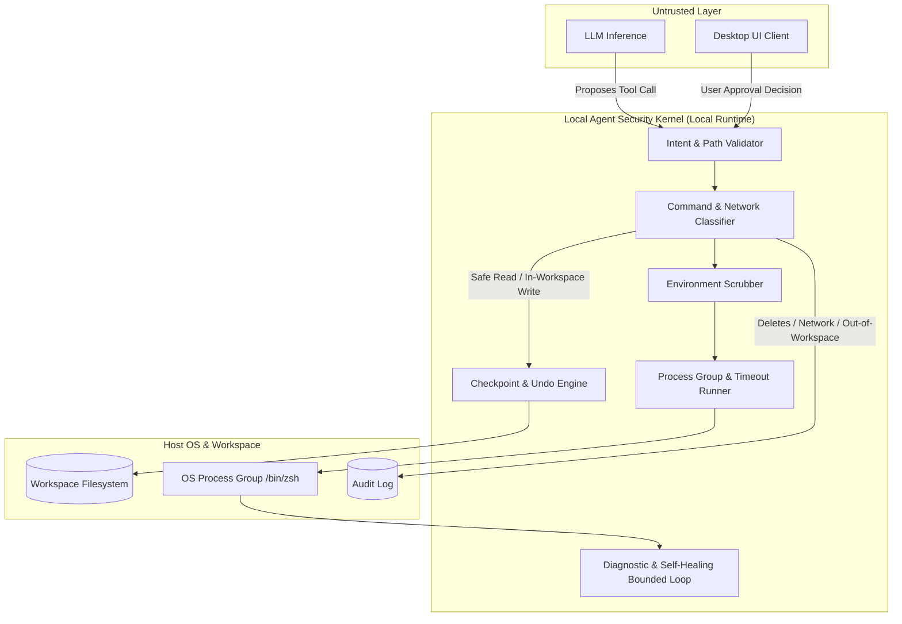

# Gram Autonomous Coding Engine: Architecture & Execution Blueprint

## Executive Overview
Gram's coding engine is designed around a fundamental security and reliability principle: **The local agent runtime is the kernel and the security perimeter—not the model, and not the frontend.** The model proposes operations, but the local agent host validates, classifies, scopes, approves/denies, checkpoints, and executes them.

This blueprint outlines the refined architecture, security policies, hardened process runner, bounded self-healing loop, and phased implementation order.

---

## 1. Core Principles & Security Perimeter

### Cross-Platform Invariant
- **Core Engine & Execution Runtime**: 100% platform-agnostic (.NET 9.0 on Windows, macOS, Linux). Shell processes dynamically resolve to `powershell.exe` (Windows), `/bin/zsh` (macOS), or `/bin/bash` / `/bin/sh` (Linux). Process tree cancellation uses .NET `Process.Kill(entireProcessTree: true)`.
- **UI Platform Layer**: Uses Photino Blazor's cross-platform windowing (WebKit on macOS/Linux, WebView2 on Windows) with `IPlatformService` supplying platform-appropriate affordances (`.os-macos`, `.os-windows`, `.os-linux`).

---

## 2. Granular Permission Policy

| Operation Type | Risk Profile | Default Policy |
| :--- | :--- | :--- |
| **Read-Only Inspection** (`view_file`, `list_directory`, `grep_search`, `find_files`, `git status`, `git diff`) | Low | **Automatic Execution** |
| **In-Workspace File Writes & Edits** (`write_file`, `edit_file`) | Medium | **Automatic by Default with Mandatory Pre-Write Checkpoint** (Undoable) |
| **Deletes, Renames, Overwrites** (`rm`, `mv`, non-atomic overwrites) | High | **Interactive Confirmation Required** |
| **Writes Outside Workspace** | Critical | **Interactive Confirmation Required** (Jailbreak alert) |
| **Network-Accessing Commands** (`curl`, `wget`, `npm install`, `pip install`, `git clone`, `docker pull`) | High | **Interactive Confirmation Required** |
| **Arbitrary Shell Commands** | High | **Classified Prior to Execution** (Never through an unrestricted raw endpoint) |
| **FullAutonomous Mode** | Exceptional | **Restricted to explicitly selected workspaces and temporary sessions only** |

### Permission Dialog Spec
When an operation requires confirmation, the prompt must explicitly provide:
1. **Operation**: Clear action type (e.g. *Install Dependencies*, *Network Request*, *Delete File*, *Out-of-Workspace Write*).
2. **Exact Target**: Full command line or targeted file path(s).
3. **Workspace**: Active workspace folder to confirm context.
4. **Network Access**: Explicit indicator whether the command attempts outbound traffic.
5. **Estimated Impact**: Brief impact summary (e.g., "Modifies package dependencies in package.json", "Permanently deletes 4 files").
6. **Approval Scope**: "Approve Once" vs "Remember for this Workspace Session".

---

## 3. Hardened Native Process Runner (Multiplatform)

Child processes spawned by the local agent must satisfy strict constraints:
- **Cross-Platform Process Tree Cancellation**: Uses .NET's native cross-platform tree kill (`proc.Kill(entireProcessTree: true)`), ensuring child subprocesses and daemon spawns terminate cleanly on cancel or timeout on Windows, macOS, and Linux.
- **Shell Resolution**:
  - Windows: `powershell.exe` with `-NoProfile -NonInteractive -ExecutionPolicy Bypass -Command ...`
  - macOS: `/bin/zsh` (default) or `/bin/bash`
  - Linux: `/bin/bash` or `/bin/sh`
- **Hard Timeouts**: Strict configurable timeouts (e.g., 30s–120s max).
- **Bounded Output**: Output buffers capped at 64KB/128KB with head/tail preservation to prevent memory ballooning and LLM context saturation.
- **Environment Scrubbing**: Automatically strips API keys and sensitive host secrets (`ANTHROPIC_API_KEY`, `OPENAI_API_KEY`, `GEMINI_API_KEY`, `AWS_*`, `GITHUB_TOKEN`, etc.) from child process environments unless an explicit tool whitelist exists.
- **Working-Directory Enforcement**: Execution working directory is strictly jailed to the active workspace path.
- **Audit Records**: Every process launch, approval record, exit code, and runtime duration is persisted in a local structured JSONL audit trail.

---

## 4. Checkpoints & Tiered Surgical Patching

- **Pre-Write Checkpoint / Snapshot**: Before modifying or creating files, the local agent creates an in-memory or snapshot diff. If an edit produces invalid syntax or the user clicks "Undo", Gram can instantly roll back the workspace to the exact previous state without needing git commits.
- **Tiered Patching Strategy**:
  1. **Tier 1 (Normal Path)**: Exact matching.
  2. **Tier 2 (Normal Path)**: Indentation- and whitespace-tolerant matching.
  3. **Tier 3 (Protected Fallback)**: AST node replacement or line-anchor chunk replacement (requires pre-write backup).
  4. **Tier 4 (Protected Fallback)**: Full-file overwrite (requires user warning + backup).

---

## 5. Bounded Self-Healing & Verification Loop

The compiler/linter feedback loop transforms model accuracy, but must be strictly bounded:
- **Project-Detected Checks Only**: Automatically detect build systems across ecosystems (`dotnet build`, `npm test`/`npm run build`, `cargo check`, `pytest`/`ruff`). Do not guess or invent arbitrary shell test scripts.
- **Max Repair Iterations**: Strict limit of **3 attempts** per task.
- **Max Runtime Budget**: Self-healing loop bounded by a hard execution clock (e.g., 90 seconds cumulative).
- **Bounded Compiler Output**: Parses and extracts only specific compiler diagnostic tokens (`file`, `line`, `col`, `code`, `message`), discarding verbose build logs.
- **Loop / Repetition Detection**: Computes error hashes; if the exact same diagnostic error repeats across iterations, the loop halts immediately and reports the blocker to the user.
- **Locality Invariant**: The agent is strictly forbidden from modifying files outside the immediate scope of the requested task to "fix" an error.

---

## 6. High-Signal Desktop UX (Cross-Platform)

Avoid dumping walls of raw terminal logs into the conversation:
- **Compact Tool Status**:
  - `Editing 2 files`
  - `Running validation (dotnet build)`
  - `Build passed`
- **Expandable Diagnostic Drawer**: An unobtrusive drawer allows developers to click and inspect complete compiler output, command details, or execution duration when desired.
- **Platform-Adaptive Polish**: UI adapts via `IPlatformService` (`.os-macos`, `.os-windows`, `.os-linux`), respecting platform conventions (e.g., Ctrl vs Cmd shortcuts, title bar integration) while maintaining a clean, consistent design system.

---

## 7. Phased Implementation Roadmap

- [x] **Step 0: Foundation Verification, Testbed & Core Hardening (Completed)**
  - Built isolated clean testbed `GramLab` (.NET 9.0 solution with core domain + test suite).
  - Executed 5 isolated Git worktree scenarios covering bug fixes, feature creation, contract refactoring, dependency abstraction, and multi-file diagnosis.
  - Hardened core agent iteration budget (25 turns), recursive subtree listing (depth 2), and cross-platform path normalization.
- [x] **Step 1: Permission Engine & Approval State (Completed)**
  - Local agent-enforced security kernel, command risk classifier, environment scrubbing, and session approval state.
- [ ] **Step 2: Workspace-Scoped File Operations (Active Next Step)**
  - Path-traversal jailing, pre-write snapshot/checkpoint engine with instant rollback.
- [ ] **Step 3: Native Process Runner with Cancellation**
  - Cross-platform process tree cancellation, hard timeouts, bounded output buffers, and structured audit logs.
- [ ] **Step 4: Checkpoints & Surgical Patching**
  - Multi-tier matching (exact $\to$ indentation-normalized $\to$ backup-protected fallback).
- [ ] **Step 5: Validation & Self-Healing Loop**
  - Project manifest auto-detection, bounded 3-turn repair cycle, error repetition breaker.
- [ ] **Step 6: Tool-Card & Permission UI Polish**
  - Compact status summaries, detailed permission modal (network, impact, duration), and expandable diagnostic drawer.

---

## 8. Empirical Validation: GramLab Testbed & 5 Worktree Scenarios

All scenarios were executed against dedicated, isolated Git worktrees (`GramLab_wt1` through `GramLab_wt5`) and pruned immediately upon verification:

| Scenario | Objective & Operations | Initial Result | Root Cause & Resolution | Final Status |
| :--- | :--- | :--- | :--- | :--- |
| **Scenario 1** | **String Edge Cases & Bounds**: Fix `Slugify` consecutive hyphens and `TruncateWithEllipsis` negative bounds | Passed | Clean pass; verified via `dotnet test` | **Passed** (24/24 tests) |
| **Scenario 2** | **Feature Addition**: Implement `CalculateShipping` rules and author 6 edge case unit tests | Passed | Clean pass; verified via `dotnet test` | **Passed** (38/38 tests) |
| **Scenario 3** | **Contract Refactoring**: Change `CalculateTotal` return type to `PricingBreakdown` record and update consuming test suite | Passed | Clean pass; verified via `dotnet test` | **Passed** (20/20 tests) |
| **Scenario 4** | **Dependency Abstraction**: Extract `ITaxCalculator`, implement default calculator, wire DI in `OrderPricingService`, test polymorphism | Failed *(Premature exit)* | Turn budget capped at 8 turns; shallow directory exploration wasted turns; Windows-only path filtering in grep. Hardened core processing. | **Passed** (21/21 tests) |
| **Scenario 5** | **Multi-File Diagnostics**: Concurrently isolate and repair 2 failing tests across separate files (`OrderPricingService.cs` & `TextTransformer.cs`) | Passed | Clean pass; isolated failures, patched both files, and verified via `dotnet test` | **Passed** (20/20 tests) |

---

## 9. Baseline Engine Hardenings Completed (Pre-Roadmap)

The following improvements were made directly to Gram's core processing logic and apply cross-platform across all projects:

1. **Turn Budget Elasticity (`AgentWorkflows.cs`, `AgentOrchestrator.cs`)**:
   - Raised default `MaxIterations` from 8 to 25 for local Coding, Chat, and Research workflows.
   - Added an explicit stopping notification (`[Agent reached maximum loop iterations (25). Stopping.]`) to prevent silent failure when reaching the iteration ceiling.
2. **Subtree Exploration Optimization (`AgentTools.cs`)**:
   - Upgraded `list_directory` to traverse recursive subtrees up to depth 2 with automatic noise suppression (`.git`, `bin`, `obj`, `node_modules`, `.vs`). This provides complete repo structure orientation in 1 tool call rather than 4–6 calls.
3. **Cross-Platform Path Sanitization (`AgentTools.cs`)**:
   - Replaced Windows-only backslash path checks (`\\bin\\`, `\\obj\\`) with cross-platform normalized path separators (`p.Replace('\\', '/')`), ensuring build artifact ignore filters function reliably on macOS, Linux, and Windows.

