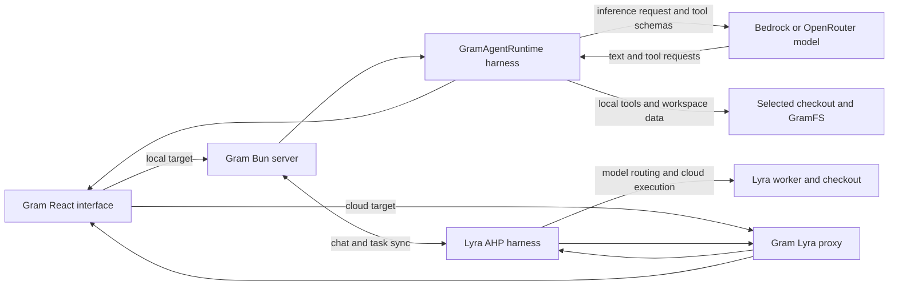

# Workspace, Chat, and Harness Design

## Purpose

This document explains how Gram currently routes a conversation and identifies a design for making workspace access, execution location, persistence, and sync predictable. It focuses on the TypeScript desktop/server path and its integration with Lyra.

## System design in plain language

Gram has four cooperating parts:

1. **The interface** is a React application displayed in a Tauri desktop window. It collects the message, current Chat or Code mode, selected project, and execution device. It displays the streamed response and tool activity.
2. **The local Gram server** is a Bun process. It serves the interface and API, owns local SQLite state and GramFS overlays, selects a model, and runs `GramAgentRuntime`. In desktop use, Tauri starts this process as a sidecar. The server's startup working directory becomes its default workspace.
3. **The Gram harness** is `GramAgentRuntime` plus the provider and tool adapters. The runtime selects a workspace, assembles system instructions and conversation history, selects tools based on mode, calls the model provider, executes returned tool calls, and returns tool results to the model. This loop runs in Gram's Bun process for the local route.
4. **The model provider** supplies inference. In the local route, Gram calls Amazon Bedrock `ConverseStream` or OpenRouter from the Bun process. Bedrock returns text and tool requests. Gram executes its local tools. Bedrock supplies the model; it does not implicitly own Gram's local file access or shell.

When the user selects a cloud device while Lyra is connected, the interface instead calls Gram's Lyra proxy. The proxy forwards the request to Lyra, and Lyra's AHP harness chooses a lane and may run a cloud worker. In this route, Lyra executes the model and its own tools. The interface remains Gram, and Gram still controls the request and displays the stream. The two routes are distinct harnesses that currently do not share a complete request contract.

### Where the current design gets confusing

The interface presents Chat and Code as modes, projects as workspace choices, and devices as execution targets. These are separate concepts, but the request and persistence code does not consistently preserve them as separate, conversation-owned state.

- The local Chat system prompt includes the runtime workspace path, project orientation, project guides, persistent workspace rules, and read-oriented tools. Some exposed Chat tools can update project guides or persistent rules, despite the prompt describing Chat as read-only.
- The tab records its session ID and model, while mode and project are held partly in global UI state. Queued turns retain a tab ID and transcript but derive their execution and save context from current global state. Changing the active tab or project while a turn is queued can mismatch the transcript, session, and workspace.
- The local runtime resolves a named project's checkout for a run, but some surrounding services continue using the server's startup workspace or GramFS instance. Workspace selection therefore does not consistently govern symbol indexing, diff/apply, and other file routes.
- The cloud route sends a `projectId` for Code, but Gram also supplies its local launch path to Lyra. The request does not clearly identify its Chat or Code intent. A Gram-local path has no reliable meaning on a remote Lyra host.
- Project identifiers, labels, conversation mode, provider, execution host, and checkout path are not carried consistently in the same session/run record. A synchronized Code conversation can be stored as Chat on a receiving instance.
- Sync acknowledges every chat ID from the upload snapshot. If a newer update is saved while that upload is in flight, the older acknowledgement can mark the newer state clean before it has been uploaded.
- The local service listens on all interfaces, while its local API routes do not consistently enforce an application-level local authorization boundary. The listen address and route authorization should be corrected before treating the desktop service as a private local-only component.

## Target design

### 1. Make the conversation the source of execution intent

Persist a session record that owns:

- `sessionId`
- `mode` (`chat` or `code`)
- optional stable `projectId`
- optional `executionTargetId`
- conversation history and revision
- created/updated timestamps

Represent whether a workspace is attached separately from the project label. An ordinary Chat session has no workspace attachment by default. A user can explicitly attach a project for grounded discussion. A Code session requires a project binding before any workspace tools run. “Continue in Code” creates a linked Code session and carries forward only the user-approved handoff context.

Keep account identity, project identity, checkout identity, and execution host identity separate. A project is the logical repository. A checkout is a particular working copy on a particular host. Paths are host-local details resolved by the execution target, not portable project identifiers.

### 2. Resolve one immutable run context

At run creation, the server validates the session and resolves a run context containing the session, mode, project, execution host, checkout, model/provider, permission profile, and cancellation ID. Persist that context with the run/checkpoint and emit it in the first stream event so the UI can show where the work is happening.

Pass the resolved context to every harness operation. File tools, symbol indexing, project instructions, diffs, overlay application, approvals, and process working directories must all use the same checkout and overlay. A named project whose checkout cannot be resolved on the selected host must fail before inference or tool execution begins.

### 3. Separate chat capabilities from coding capabilities

Define explicit capability profiles rather than relying on prompt wording alone:

- **Unattached Chat** gets no repository orientation, workspace tools, project memory, or file/shell access.
- **Attached Chat** gets only the explicitly attached project's selected read capabilities. Persistent project-memory writes require a distinct user action or are removed from conversational Chat.
- **Code** gets project tools for the resolved checkout. File edits happen in an identified overlay. Risky commands and Git/external side effects remain permission-gated.

The harness enforces each profile when it builds the tool list and again when it executes a tool. System prompts describe the active contract but do not serve as its security boundary.

### 4. Give local and cloud harnesses one request contract

Define a typed run request shared by the interface, Gram local runtime, Gram-to-Lyra proxy, and Lyra harness. It carries the stable session and project IDs, mode, execution target, optional file context, permission profile, model preference, and request revision. It does not treat a path on one machine as a path on another.

The interface requests an execution target. Gram resolves a local target to a registered local checkout. Lyra resolves a cloud target to its own checkout or isolated worktree. Both harnesses report the resolved host, checkout/project identity, provider/model, and lane in run metadata. Lyra can still apply its own execution lanes, provided the user-visible mode and permission contract are preserved.

### 5. Make persistence and sync revision-safe

Use stable turn IDs and monotonically increasing session revisions. An upload sends a snapshot at revision `r`. The server acknowledges the accepted revision. Gram marks the local record clean only if its current revision is still `r`; a newer local revision remains dirty. Persist and sync the session mode and stable project/execution metadata.

Use authenticated account identity for cloud sync. Keep local-only records local when the user has not connected an account. Define merge behavior for concurrent edits explicitly, using per-turn identity or an append-only event log where merging whole transcript snapshots would lose updates.

### 6. Treat the desktop server as a privileged boundary

Bind the desktop Bun server to loopback by default. Add an origin-checked, per-install local credential for privileged API routes, including file writes, process control, run control, approvals, and project changes. Do not assume that a desktop app's API is safe merely because its normal UI uses localhost. Keep hosted Lyra authentication and authorization at Lyra, where it already owns identity.

## Implementation plan

### Phase 0: Contracts and regression cases

1. Write down the local and cloud request/response contract, session lifecycle, project and checkout identifiers, and capability profiles.
2. Add focused tests for mode/project ownership, execution-host resolution, cross-tab queued sends, session sync metadata, concurrent sync acknowledgements, and local API authorization.
3. Establish the intended acceptance flow: an unattached personal chat gets no repository content; two Code sessions bind to different projects; queueing or switching tabs cannot change either session's target; local and cloud runs display their actual execution target.

### Phase 1: Close the desktop API boundary

1. Bind the desktop server to `127.0.0.1` by default and make any network-listening mode explicit.
2. Apply one authorization middleware to privileged local routes. Include origin/host checks and a per-install token, with a documented development path.
3. Audit the direct workspace routes and approval/run endpoints so their target and authorization are validated server-side.

This phase has priority because the local harness can read files, run processes, modify overlays, and commit changes.

### Phase 2: Bind sessions and turns to explicit targets

1. Extend session and run types/database migrations with mode, stable project ID, execution target ID, and revision. Preserve legacy rows with a deliberate migration default and allow a user to review ambiguous legacy bindings.
2. Move execution-critical mode/project state out of global React state and into each tab/session.
3. Capture the entire target context when creating a queued turn. Execute and save using that captured session, project, and mode even if the user switches tabs before dispatch.
4. Make local checkout resolution explicit and host-scoped. Remove uses of the server root as an implicit project fallback for Code runs.

### Phase 3: Unify workspace enforcement in the runtime

1. Introduce one resolved run context object and pass it through prompts, tool execution, GramFS, process management, symbol indexing, diff/apply, approval resumption, and event emission.
2. Associate each GramFS overlay with a checkout/run. Ensure review and commit endpoints use the same overlay instance and target recorded on the run.
3. Make approval records carry the resolved checkout and action. Revalidate that binding on approval rather than reconstructing it from current global state.

### Phase 4: Define Chat and Code capability profiles

1. Remove workspace context and repository tools from unattached Chat.
2. Add an explicit attach-project action for read-only project discussion, with visible attached-project state.
3. Keep memory/guide updates out of the read-only capability profile, or expose them as explicit user-approved actions.
4. Require the Code profile to resolve a project checkout and use server-side capability checks for every tool call.

### Phase 5: Bring Lyra onto the same contract

1. Update Gram's proxy to send mode, stable project ID, target intent, and permissions without forwarding Gram's local filesystem path as a cloud path.
2. Update Lyra's session binding so an existing session cannot silently switch workspace when a request supplies a different target. Validate user ownership of the session and project.
3. Resolve cloud projects to per-run isolated checkouts/worktrees and return the resolved target metadata.
4. Test local Bedrock inference, local OpenRouter inference, and Lyra cloud execution separately. Keep provider/model identity distinct from harness and execution-host identity in the UI and records.

### Phase 6: Repair sync semantics and rollout

1. Add session mode and stable project metadata to sync serialization and persistence.
2. Acknowledge exact uploaded revisions and preserve dirty state for changes made after the upload snapshot.
3. Test simultaneous updates, retries, duplicate delivery, delete/update races, and offline reconnect behavior.
4. Roll out behind a migration-safe compatibility layer. Log selected target IDs and resolved project identity, but avoid logging prompts, file contents, credentials, or unnecessary absolute paths.

## Acceptance criteria

- Unattached Chat receives no workspace path, project guide, repository files, or workspace tools.
- Attached Chat receives only the selected project's explicitly allowed read context.
- Code tools, symbol lookup, overlays, diff/review, approvals, and processes resolve to the same checkout for a run.
- Every tab and queued turn keeps its own session mode and target through tab/project switching.
- A missing local/cloud checkout fails before the model receives the task.
- Both local Gram and Lyra preserve the same user mode, project identity, and permission contract while reporting their actual execution host and provider/model.
- Sync round-trips mode and target metadata and cannot acknowledge a newer unsent revision.
- Privileged desktop API routes reject unauthorized origins/clients and the desktop listener is loopback-only by default.

## Implementation status

The first Gram-side changes now make unattached Chat omit repository context and project tools, bind run mode and project ID to the selected tab when sending and saving a turn, preserve mode and revision in local sync records, and only acknowledge the exact chat revision sent. The desktop Bun listener now binds to loopback by default. Gram no longer forwards its local startup path as Lyra's workspace path, and includes the session mode and project ID in the cloud request.

Remaining work includes an explicit project-attachment control for read-only Chat, consistent checkout/GramFS binding for symbol indexing, diff/apply and approvals, authenticated authorization for privileged local API routes, device binding on queued turns, and Lyra-side persistence/validation of mode and revision. TypeScript type checking passed after the Gram changes. Lyra end-to-end behavior and test suites have not been rerun as part of this implementation.
